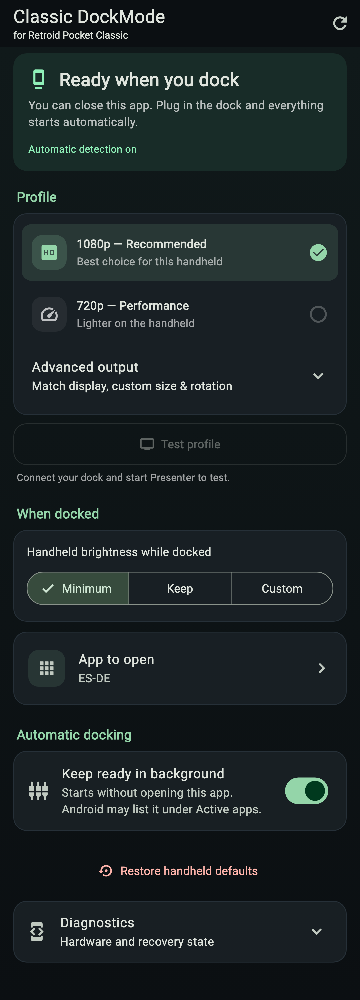
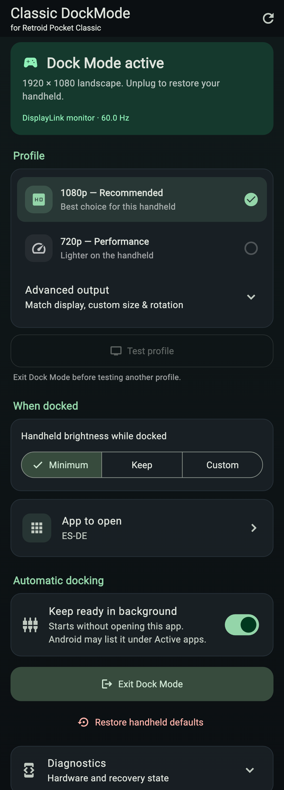

# Classic DockMode

Dock your **Retroid Pocket Classic**, play on the big screen, then unplug to return to handheld mode.

Classic DockMode works alongside [DisplayLink Presenter](https://play.google.com/store/apps/details?id=com.displaylink.presenter). It sets a landscape render resolution, optionally dims the handheld, and opens your chosen app. Presenter handles the video output.

**[Download the APK](https://github.com/gevky/classic-dockmode/releases/latest)** · [Report a problem](https://github.com/gevky/classic-dockmode/issues)

<p>
  
  
</p>

*UI previews captured from the app's Flutter widgets with illustrative device data. These are not photographs or evidence of a hardware test.*

## What you need

- **Retroid Pocket Classic**, a **USB DisplayLink dock**, and DisplayLink Presenter.
- A computer with [Android Platform Tools](https://developer.android.com/tools/releases/platform-tools) for the one-time permission grant.

The development setup is a **Retroid Pocket Classic + Dell D6000 + Presenter**. Other handhelds and docks are unverified. A normal USB-C HDMI adapter is not a substitute for a DisplayLink dock. This is an early community release; firmware differences may affect system access and app launching.

## Setup in 4 steps

### 1. Enable debugging

Install DisplayLink Presenter. On the handheld, tap **Settings → About device → Build number** seven times, then enable **Developer options → USB debugging**.

Connect it to your computer and accept the debugging prompt. Confirm it appears with:

```sh
adb devices
```

To keep USB-C free for the dock, use **Wireless debugging** instead: on the same Wi-Fi network, open **Pair device with pairing code**, run `adb pair IP:PAIR_PORT`, then `adb connect IP:DEBUG_PORT`. The pairing and connection ports are different. Normal docking does not need ADB.

### 2. Install and grant access

Download `classic-dockmode.apk` from [Releases](https://github.com/gevky/classic-dockmode/releases/latest), then run:

```sh
adb install -r classic-dockmode.apk
adb shell pm grant com.displaylinkdock.displaylink_dock_companion android.permission.WRITE_SECURE_SETTINGS
```

The grant normally prints nothing. Updates retain it; uninstalling requires granting it again. The package name is kept for compatibility with earlier releases.

### 3. Finish setup in the app

Open **Classic DockMode**, tap **Grant Modify Settings**, and enable access. Return and tap **Check system access**. The check verifies the permission; it cannot grant the ADB permission for you.

### 4. Connect and choose your settings

Connect the dock and start Presenter, accepting its prompts. Keep **1080p — Recommended**, choose handheld brightness, and select **App to open**. ES-DE, Daijishō, Beacon, emulators, games, and streaming apps all use their normal launch flow. Choose **Don't open anything** to leave your current app alone.

With **Keep ready in background** enabled, future connections can start Dock Mode without opening this app. Unplugging restores the saved handheld resolution, rotation, and brightness.

## Profiles and background mode

| Setting | Behavior |
| --- | --- |
| 1080p — Recommended | Default 1920 × 1080 landscape target; no initial test required. |
| 720p — Performance | Lower rendering load at 1280 × 720. Test and keep once. |
| Advanced output | Match the monitor, set a custom landscape size, or adjust rotation. |
| Test profile | A 15-second reversible test. Choose **Keep**, or it reverts. |
| Keep ready in background: on | Detects the dock while the UI is closed. Android may list it in **Active apps**. |
| Keep ready in background: off | No idle listener after closing the app. Keep it open when connecting. |

Active dock sessions keep their recovery service until disconnect, even with background detection off. Android 13+ can show that service in **Active apps** without a permanent notification in the notification drawer.

Presenter controls the transport refresh rate; this app only reports it. Higher render resolutions increase GPU load. Shizuku support is not included in this release: the direct ADB-grant backend must work on your firmware.

## Troubleshooting and recovery

- **Missing permission:** repeat the grant in step 2. `adb devices` must show `device`, not `unauthorized`.
- **No automatic docking:** enable **Keep ready in background**, open the app once, and reconnect. Android force-stop or stopping it from **Active apps** prevents background detection until you open it again.
- **Frontend does not open:** reselect it, disconnect, wait a few seconds, and reconnect. Include your Android version in a report; background app launches depend on firmware.
- **APK cannot be parsed:** download the actual `.apk` release asset again. An HTML download page renamed to `.apk` will not install.
- **Need to undo changes:** tap **Restore handheld defaults**. It works without an external display. In an emergency, use:

```sh
adb shell wm size reset
adb shell settings put system accelerometer_rotation 1
```

The emergency commands reset display size and enable auto-rotation; the app normally restores your exact saved values. Restore before uninstalling or clearing app data, which removes that saved state.

For a bug report, include your handheld, Android version, dock, Presenter version, and **Diagnostics → Copy diagnostics**. Do not include serial numbers or other personal information.

## Build from source

Use Flutter with Dart 3.13.1+, JDK 17, Android SDK 36, and the NDK version selected by Flutter. From this directory:

```sh
flutter pub get
flutter analyze
flutter test
flutter build apk --release --target-platform android-arm64
```

The output is `build/app/outputs/flutter-apk/app-release.apk`. Current builds use the local Android debug signing key, including the downloadable community build. Keep the same signing key for updates; builds signed with another key cannot update the installed APK. Signing keys and local SDK paths are excluded from the repository.

To regenerate the documented UI previews, set `FLUTTER_ROOT` to your SDK and run `flutter test --update-goldens tool/screenshots_test.dart`. The previews exercise the actual widgets with a mock Android channel; they do not validate dock hardware.

## Privacy and credits

No accounts, analytics, or advertising. Preferences and recovery state are stored locally, with Android backup disabled. Installed app names are used only for the app picker.

An independent community project, unaffiliated with Retroid, DisplayLink/Synaptics, or Dell. Product names belong to their respective owners.
